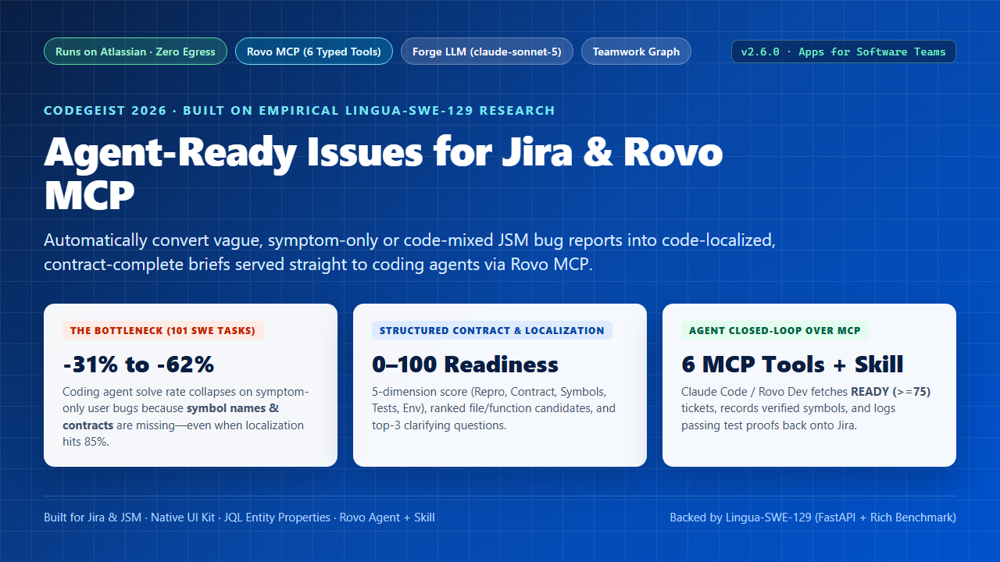
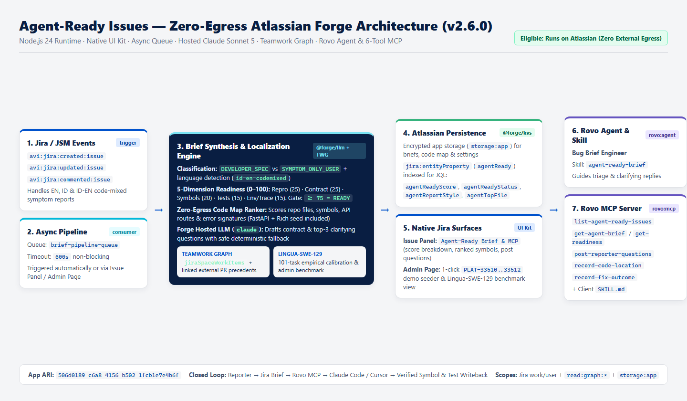
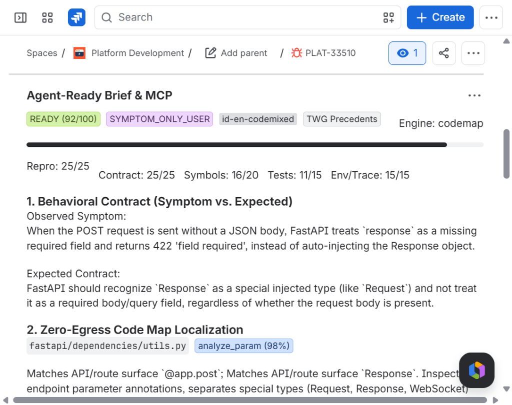
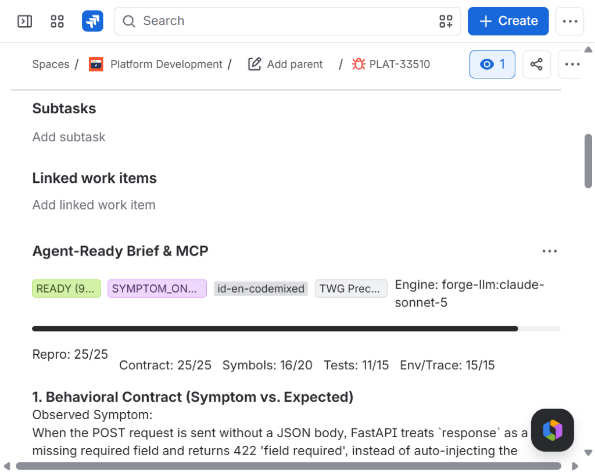

# Agent-Ready Issues for Jira & Rovo MCP



**Turn symptom-only customer bug reports in Jira & JSM into code-localized, testable engineering briefs served directly to coding agents over Atlassian Rovo MCP.**

Built for **Atlassian Codegeist 2026**:
- **Primary Category:** Apps for Software Teams (`$15,000 / $8,000 / $5,000`)
- **Bonus Prizes Targeted:**
  1. **Best App with Atlassian MCP (`rovo:mcp`)** — Exposes 6 typed tools to Rovo Studio and external MCP coding agents (`https://mcp.atlassian.com/forge/<appId>`) + ships an open-source client skill (`client-skill/fix-from-agent-brief/SKILL.md`).
  2. **Best Rovo Agent & Skill (`rovo:agent` + `rovo:skill`)** — Ships **Bug Brief Engineer** (`bug-brief-agent`) backed by the `agent-ready-brief` Rovo Skill (`skills/agent-ready-brief/SKILL.md`).
  3. **Runs on Atlassian Eligible (`llm` module, Zero Egress)** — Uses Atlassian-hosted Forge LLMs (`@forge/llm`, `claude-sonnet-5` / `claude-sonnet-4-6`) and an in-Forge zero-egress symbol Code Map with zero external network calls.

---

## Why We Built This (Measured Empirical Gap)

In our 101-task benchmark study (**Lingua-SWE-129**, published under CC BY 4.0 at `https://www.kaggle.com/datasets/antonpraf/lingua-swe-129`), rewriting developer pull-request specifications into realistic **symptom-only user reports** caused coding-agent solve rates to drop by **31% on 31B models** and **62% on 12B models** (patch failure rates jumped from 60% to 72–89%).

Crucially, our trace analysis showed that coding agents still reached the right file 83–85% of the time—what failed was **identifying the exact target function/symbol** and **knowing the intended behavioral contract**. Furthermore, when users wrote in **code-mixed Indonesian** while keeping code identifiers in English, solve rates suffered **0% loss**.

**Agent-Ready Issues for Jira** bridges this exact support-to-engineering handoff:
1. **5-Dimension Agent Readiness Score (0–100):** Scores every Jira/JSM issue across *Reproduction Steps (25)*, *Expected vs. Actual Contract (25)*, *Code-Map Symbol Localization (20)*, *Acceptance Criteria (15)*, and *Environment/Trace Context (15)*, indexed into Jira Entity Properties (`agentReadyScore`, `agentReadyStatus`) for JQL and Automation.
2. **Zero-Egress Code Map Localization:** Ranks candidate files and symbols (`fastapi/dependencies/utils.py :: analyze_param`, `rich/console.py :: Console.print`) inside Forge KVS without ever exporting source-code bodies outside your repository.
3. **Ask the Reporter Instead of Guessing:** When a ticket scores `< 75`, generates at most 3 ranked clarifying questions in **English and Indonesian** and posts them to the issue in one click.
4. **Closed-Loop Rovo MCP Server (`rovo:mcp`):** Coding agents pull ready briefs (`list-agent-ready-issues`, `get-agent-brief`), pin verified root-cause symbols (`record-code-location`), and report failing-to-passing test outcomes (`record-fix-outcome`).

---

## Architecture (Zero-Egress Forge Pipeline)



## Live Atlassian Screenshots

| Jira Issue Panel (`PLAT-33510`, Code Map Engine) | Jira Issue Panel (`PLAT-33510`, Hosted Forge LLM) |
| --- | --- |
|  |  |

---

## Repository Layout

```text
agent-ready-issues/
├── manifest.yml                                  # Forge manifest (UI Kit, rovo:mcp, rovo:skill, rovo:agent, llm)
├── package.json
├── src/
│   ├── index.js                                  # 10 Forge handlers (UI resolver, triggers, consumer, 6 MCP actions)
│   ├── briefEngine.js                            # 5-dimension readiness scorer + @forge/llm synthesis + deterministic fallback
│   ├── codeMapRanker.js                          # Zero-egress lexical + symbol + route + error-string ranker
│   ├── twgSimilarIssues.js                       # Atlassian Teamwork Graph query for similar resolved bugs & linked PRs
│   ├── benchmarkData.js                          # Lingua-SWE-129 empirical data + 1-click Judge Seed scenarios
│   ├── storage.js                                # @forge/kvs storage layer with batching & timeout guards
│   ├── jiraClient.js                             # Jira REST v3 + ADF comment builder + entity property sync
│   └── frontend/
│       ├── issue-panel.jsx                       # Native UI Kit Jira Issue Panel
│       └── admin-page.jsx                        # Native UI Kit Jira Admin Console & Benchmark Dashboard
├── skills/
│   └── agent-ready-brief/                        # Bundled Rovo Skill (rovo:skill)
│       ├── SKILL.md
│       └── references/
│           ├── brief-schema.md
│           └── question-bank.md
├── client-skill/
│   └── fix-from-agent-brief/
│       └── SKILL.md                              # Open-source skill for Claude Code / Cursor / Rovo Dev
├── scripts/
│   └── export-codemap.js                         # Local/CI script to export zero-egress symbol code maps
└── test/
    ├── app.test.js                               # Automated unit & MCP lifecycle tests
    └── validate-manifest.js                      # Manifest & Rovo Skill validator
```

---

## Quick Test & Deployment Guide

### 1. Run Local Unit & MCP Lifecycle Tests
```bash
cd agent-ready-issues
npm test
npm run lint:manifest
```

### 2. Deploy to Your Atlassian Forge Site
```bash
npm install -g @forge/cli@latest
forge login
forge register
forge deploy -e production
forge install --upgrade
```

### 3. Testing Instructions for Judges (1-Click Demo Seed)
1. Open **Jira Settings -> Apps -> Agent-Ready Issues Settings & Benchmark** (Live demo: `https://one-atlas-rrth.atlassian.net/jira/settings/apps/506d0189-c6a8-4156-b502-1fcb1e7e4b6f/26057567-7107-47e7-b0e9-d5c3feeef962`).
2. Click **1-Click Seed Lingua-SWE-129 Demo Scenarios** to populate the reference Code Map (`fastapi` + `rich`) and benchmark tickets (`DEMO-101..103` + live Jira tickets `PLAT-33510`, `PLAT-33511`, `PLAT-33512`).
3. Open any Jira issue (e.g. `https://one-atlas-rrth.atlassian.net/browse/PLAT-33510`) to view the **Agent-Ready Brief & MCP** panel, or open Rovo Chat and select **Bug Brief Engineer**.
4. To connect an external coding agent (Claude Code / Cursor):
   - Enable the app's tools in *Atlassian Admin -> Apps -> Sites -> Connected apps*.
   - Run:
     ```bash
     claude mcp add --transport http agent-ready-issues https://mcp.atlassian.com/forge/506d0189-c6a8-4156-b502-1fcb1e7e4b6f
     ```
